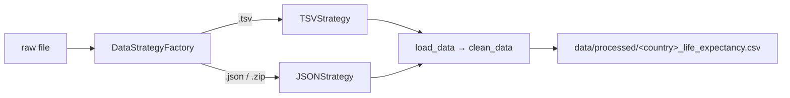

# Life Expectancy Data Pipeline

[](https://github.com/filipe-carmo/dare-data-assignments/actions/workflows/python-app.yml)


[](LICENSE.md)

A small, fully tested Python pipeline that turns raw Eurostat life expectancy exports (wide TSV, or JSON inside a ZIP) into a tidy, per-country CSV. It is a deliberately compact example of how I structure data code: a clear extension point for new input formats, typed interfaces, tests on fixtures, and CI that lints and tests on every push.

## What it does

The raw TSV packs four dimensions into its first column and one column per year:

```text
unit,sex,age,geo\time   2021   2020   2019 ...
YR,F,Y1,PT              :      83.3   84.0 ...
```

The pipeline splits the metadata, reshapes to long format, strips Eurostat flags (`b`, `e`, `p`) from the values, drops missing values (`:`), and keeps one country:

```text
unit,sex,age,region,year,value
YR,F,Y1,PT,2020,83.3
YR,F,Y1,PT,2019,84.0
```

## Design



- **Strategy pattern.** Each input format implements the `FileStrategy` protocol (`load_data`, `clean_data`), and every strategy emits the same output schema.
- **Factory.** `DataStrategyFactory` picks the strategy from the file extension and fails fast on unsupported formats. Supporting a new format means adding one class.
- **Typed regions.** Countries and aggregates are a `Region` enum, so an invalid country code is caught at the CLI instead of producing an empty file. `Region.actual_countries()` filters out aggregates such as `EU27_2020`.

## Quick start

```bash
git clone https://github.com/filipe-carmo/dare-data-assignments.git
cd dare-data-assignments
python -m venv .venv && source .venv/bin/activate
pip install -e ".[dev]"
```

Put a raw Eurostat export in `life_expectancy/data/raw/` (the data folder is git-ignored), then run:

```bash
life-expectancy --country PT --file eu_life_expectancy_raw.tsv
# Saved 3050 rows for PT  →  life_expectancy/data/processed/pt_life_expectancy.csv
```

`python -m life_expectancy.cleaning` works too. From Python:

```python
from life_expectancy.cleaning import Region, main

df = main(country=Region.ES, file_name="eurostat_life_expect.zip")
```

## Tests and quality

```bash
pytest --cov=life_expectancy life_expectancy/tests/   # 13 tests, ~99% coverage
pylint life_expectancy                                 # 10.00/10
```

GitHub Actions runs both on Python 3.11, 3.12 and 3.13 for every push and pull request.

## Project structure

```text
.
├── .github/workflows/     # CI: pylint + pytest on a Python version matrix
├── docs/course_materials/ # Original assignment briefs from the course
├── life_expectancy/
│   ├── cleaning.py        # Strategies, factory, pipeline and CLI
│   └── tests/             # Unit tests and fixture data
└── pyproject.toml         # Packaging, dependencies, lint and coverage config
```

## Background

Built by **Filipe Carmo** during the DareData Engineering *Foundations Learning Path*. DareData provided the problem statement and the initial project skeleton (the original briefs are in [`docs/course_materials`](docs/course_materials)); the pipeline, refactors and tests are my own work.

## License

MIT, see [LICENSE.md](LICENSE.md).
